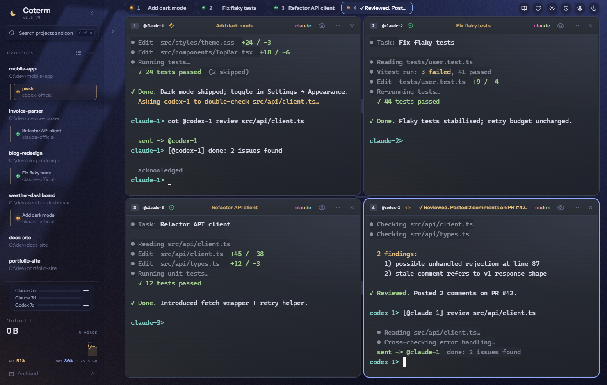
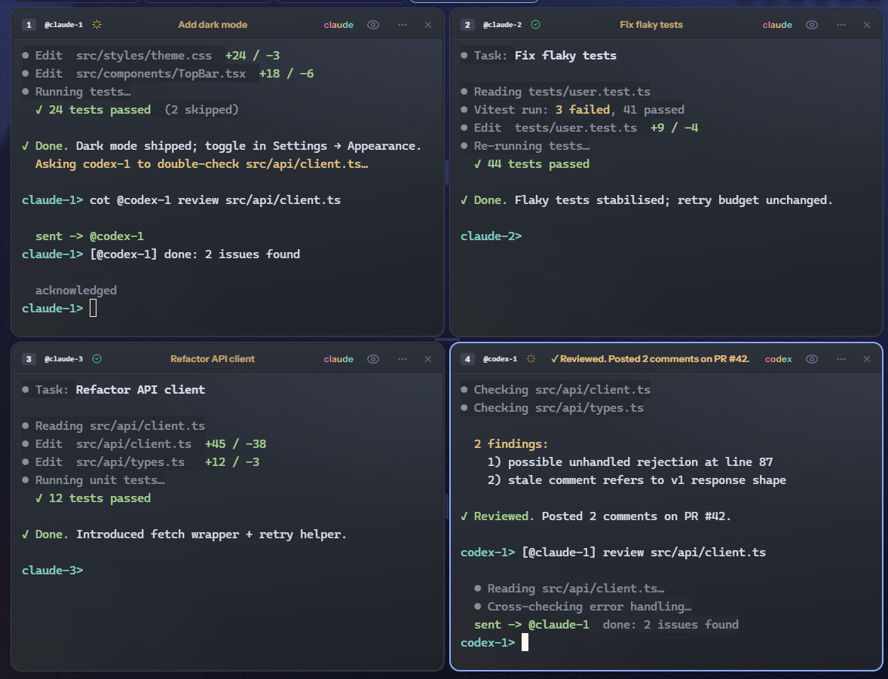
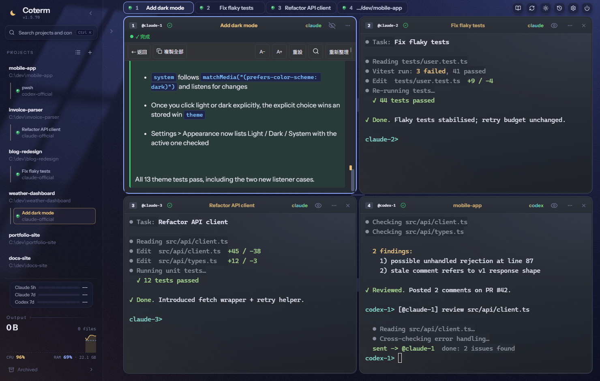
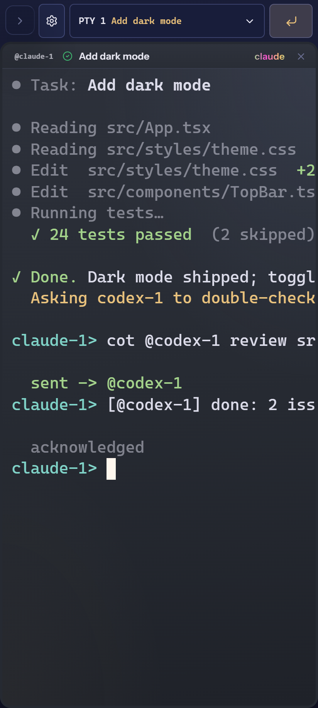
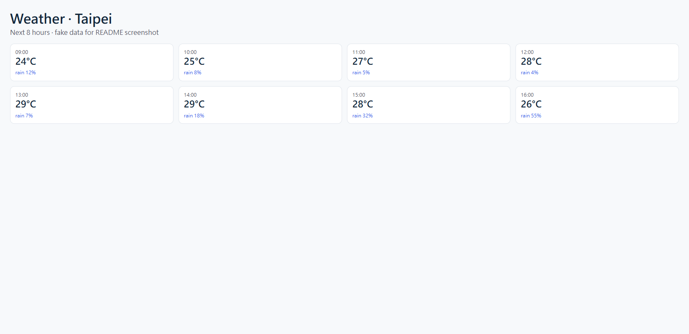
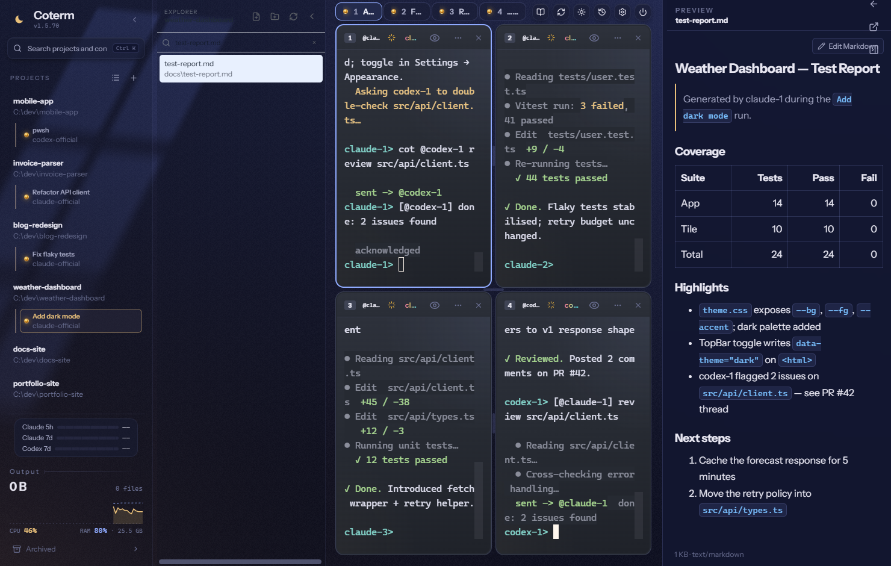
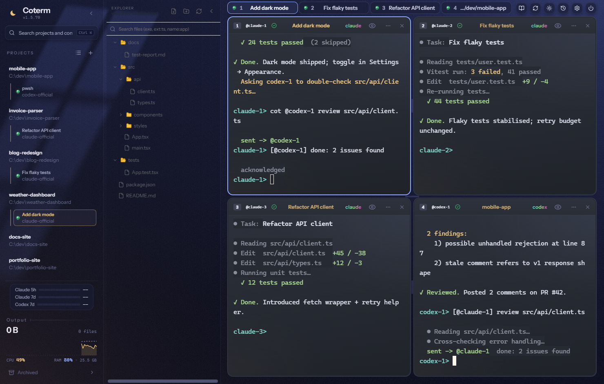

# Coterm

**My personal terminal for running AI agents. Use it if you like it; if not, there are plenty of others.**
I'm not a programmer, so it's built to need no commands: click to open a session, click to start Claude Code, Codex or Gemini CLI. My agents live in one workspace, open windows for each other, hand off work, and report back.

It's deliberately minimal — tools like herdr or orca have far more features. This is just the set I actually use.

> **Fastest install:** tell your own AI agent: *"Read `skills/coterm-setup/SKILL.md` and set up Coterm for me."* It will install Coterm, connect your own AI CLI and models, and walk you through every button.

## Highlights


*Four agents in one workspace.*

1. **Agents that dispatch agents** — one agent opens a new pane, starts Codex in it, sends a task, and waits (event-driven, no polling) until it finishes. Built-in Agent API + MCP server.
2. **Every pane has a name, agents can talk** — panes get short handles like `claude-1`, `codex-2`; agents from different vendors pass messages and hand off work with `cot @codex-2 ...`.
   
3. **Reading mode** — hide all the tool calls and noise, read only what you asked and what the AI concluded. Works on your phone too.
   
4. **Your desk on your phone** — mirror the whole workspace to your phone or browser and keep driving it, behind Tailscale or Cloudflare Access.
   
5. **See what your agents are doing to your machine** — live CPU / RAM, how many files this session wrote, and which file is growing fastest.
6. **A real browser for your agents** — headless Chromium your agents can open, click, fill and screenshot through the API.
   

## Also included

- Attention inbox and pane status lights; a desktop notification when the main agent finishes (subagents stay quiet)
- Right-side preview panel: open a Markdown file from the Explorer and read it rendered, without leaving the app
  
- Handoff packets: pack goal, decisions, evidence and files from one conversation for another agent to continue
- Git worktree sandboxes per agent, with trusted resume
- Checkpoints: see what each turn changed, roll back a turn or a single hunk, preview first
- Usage meters for Claude 5h/7d and Codex 7d limits, and a context battery per pane
- Command palette (`Ctrl+Shift+P`), in-terminal search, shell integration (pwsh 7)
- Native PTY panes: agent TUIs, slash commands and OAuth logins work exactly as in a normal terminal
- Voice dictation and voice commands *(experimental)*

**Platform:** Windows first (fully tested). macOS / Linux build from source, not yet tested.

---

## 繁中簡介

**我自己在用的 AI agent 終端機。喜歡就拿去用，不喜歡就用別家。**
我不是工程師，所以做成不用打任何指令：點一下開對話、點一下啟動 Claude Code／Codex／Gemini CLI。功能刻意精簡，比不上 herdr、orca 這些工具豐富，只放我自己真的會用的。
最快安裝：叫你自己的 AI 讀 `skills/coterm-setup/SKILL.md`，它會幫你裝好、接上你自己的模型、教你每個按鈕。

亮點：agent 幫你開視窗派工給別的 agent｜每個視窗有編號，不同家的 AI 能互相傳話｜閱讀模式只看結論（手機也能用）｜手機遠端操作整個桌面｜即時看 CPU／記憶體與哪個檔案在長大｜agent 專用的內建瀏覽器。

---

## Install

**Prebuilt installer** — download `Coterm-<version>-Setup.exe` from releases and double-click to install.

**From source** —

```bash
git clone <repo-url> coterm
cd coterm
npm install
npm run dev      # launch dev app
npm run dist     # build release/Coterm-<version>-Setup.exe
```

Requirements: Node.js 24.x (see `.node-version` and `package.json`) and the provider CLIs you intend to use (`claude`, `codex`, etc.). See [docs/PLATFORM-SUPPORT.md](docs/PLATFORM-SUPPORT.md).

## Using Coterm

- **Remaining quota (TopBar)** — the three compact bars show how much of your Claude 5h / Claude 7d / Codex 7d quota is *left* (not used). Green > 30% remaining, yellow 5–30%, red ≤ 5% (a short red bar means almost out). Hover for the reset countdown and data age. This is account-level quota; missing official cache/session data renders as `--`.
- **PTY lamps (1–8)** — each terminal button carries a three-tone signal: **yellow** = agent is outputting/computing, **green** = idle, waiting for the next prompt or turn finished, **red** = needs a human decision (approval, choice, error). The lamp turns yellow on real output activity and settles to green after ~2.5 s of quiet; a red attention state is never auto-cleared by the quiet timer — your input or approval is the only exit.
- **Context battery** — supported profiles show a 10-segment context-window battery, read from each profile's own session file every 10 s. Some models' usage reports are unreliable, so their profiles stay hidden.
- **Explorer → Copy Path** — right-click a file or folder in the Explorer panel and choose *Copy Path* to put its absolute path on the clipboard. Click outside, press Esc, or scroll to dismiss the menu.
  
- **Select & copy in a terminal** — select text directly in the xterm canvas with the mouse; `Ctrl+C` copies when there is a selection (and interrupts when there is not). On mobile, long-press the selected text for the system copy menu. There is no separate copy mode.

## Customize your proxy

Coterm reads `<userData>/profiles.json` on startup. Point any `local: true` profile at your own proxy by editing two lines:

```json
{
  "proxyUrl": "http://my-proxy:8080",
  "authToken": "my-token"
}
```

Full field reference, validation behavior, and a complete worked example are in [docs/CUSTOMIZING.md](docs/CUSTOMIZING.md).

## Platform support

| Platform | Tier |
|----------|------|
| Windows  | 1    |
| macOS    | 2    |
| Linux    | 2    |

Details and known gaps per platform: [docs/PLATFORM-SUPPORT.md](docs/PLATFORM-SUPPORT.md).

## Documentation

- [ABCDEF user guide](docs/ABCDEF_USER_GUIDE.md) — command palette, terminal engine, attention, worktree sandboxes, trusted resume, and checkpoints.
- [ABCDEF agent contract](docs/ABCDEF_AGENT_GUIDE.md) — what external and in-terminal agents may call, plus mandatory safety rails.
- [Architecture](docs/ARCHITECTURE.md) — module boundaries and data flow.
- [Customizing](docs/CUSTOMIZING.md) — proxy, settings, and agent API without editing core code.
- [Platform support](docs/PLATFORM-SUPPORT.md) — tier matrix and per-OS notes.
- [Release checklist](docs/RELEASE.md).

## License

MIT — see [LICENSE](LICENSE).
